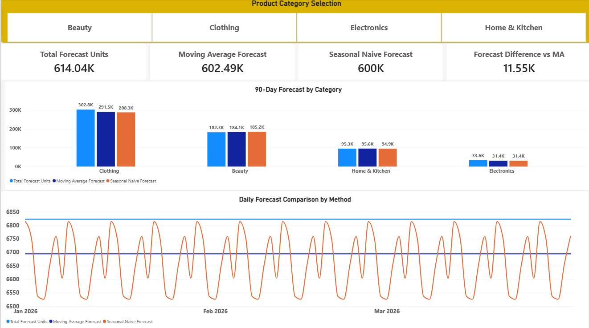
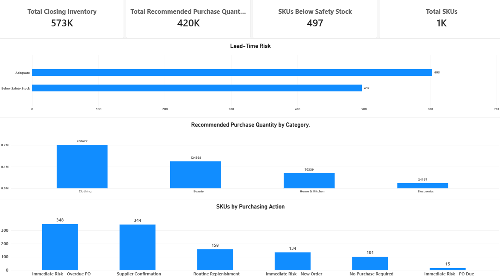
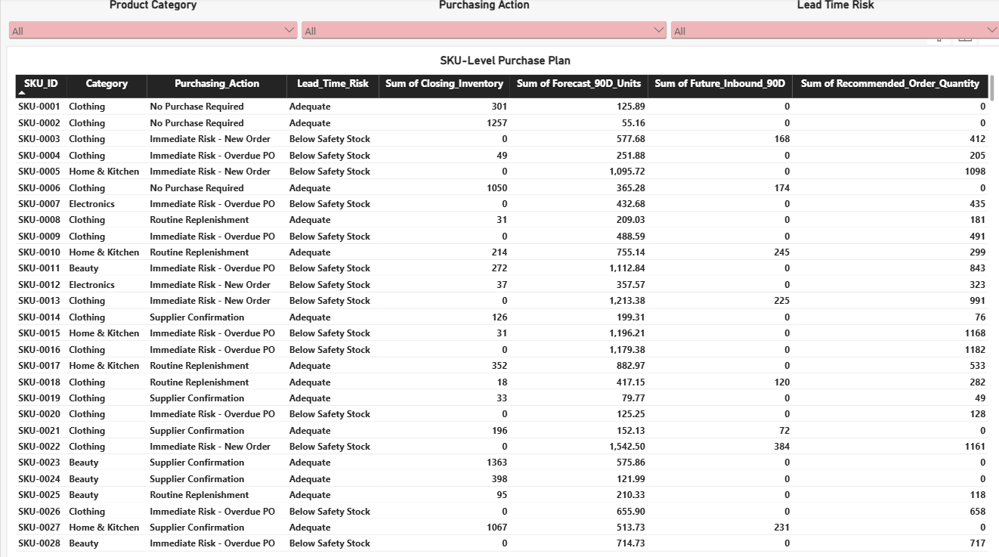
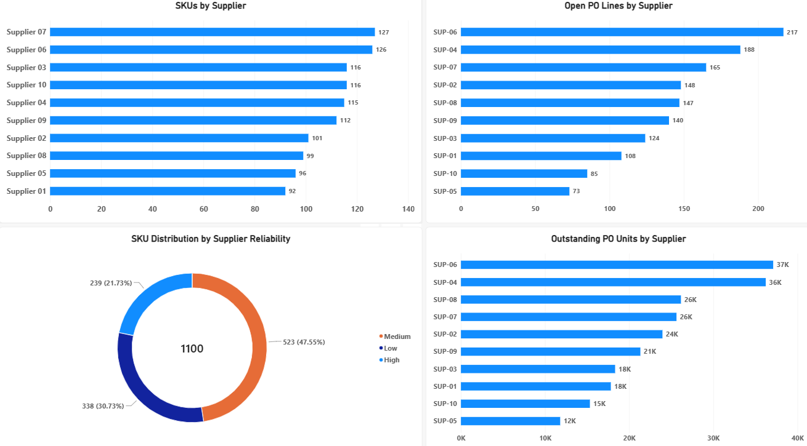

# MarketPulse Retail – Demand Forecasting & Purchasing Analysis

## 1. Project Overview

This project focuses on demand forecasting and purchasing planning for a fictional online retailer, MarketPulse Retail.

The objective was to use historical sales, inventory and supplier information to understand product demand, forecast future requirements and identify products that may need replenishment.

The analysis covers **1,100 SKUs across four product categories**, using daily sales data from January 2024 to December 2025.

A 90-day demand forecast was prepared for January–March 2026. This forecast was then combined with inventory balances, outstanding purchase orders and supplier lead times to develop SKU-level purchasing recommendations.

All data used in this project is synthetic and represents a fictional business.

## 2. Business Objectives

The project addresses the following business questions:

- How have sales performed across product categories and individual products?
- Which products have stable, intermittent, growing, declining or seasonal demand patterns?
- Which forecasting method provides a reasonable starting point for future demand planning?
- How much demand is expected over the next 90 days?
- Which products may face inventory shortages based on supplier lead times?
- How should outstanding purchase orders be considered before placing new orders?
- Which products require immediate attention, supplier confirmation or routine replenishment?

## 3. Tools and Technologies

| Tool | Usage |
|---|---|
| Python | Data generation, analysis and forecasting |
| Pandas and NumPy | Data preparation and calculations |
| Matplotlib | Data visualisation |
| DuckDB | Data storage and querying |
| Jupyter Notebook | Analysis workflow |
| Excel | Analysis outputs and purchasing summaries |
| Power BI | Interactive dashboard |
| Git and GitHub | Version control and project sharing |

## 4. Analysis Approach

### 4.1 Historical Sales and Inventory Analysis

- Analysed 804,100 daily SKU records covering two years.
- Recorded approximately 4.05 million units sold.
- Examined sales trends across four product categories.
- Analysed product availability and the effect of stockouts on recorded sales.

### 4.2 SKU Demand Classification

Products were classified using three demand characteristics:

**Demand variability**
- Smooth demand
- Intermittent demand

**Demand trend**
- Growing
- Stable
- Declining

**Seasonality**
- Seasonal
- Non-seasonal

The analysis identified:
- 877 SKUs with smooth demand and 223 with intermittent demand.
- 248 SKUs with growing demand, 653 stable and 199 declining.
- 269 SKUs with an identifiable seasonal pattern.

These classifications help distinguish products with different demand behaviours and provide additional context for forecasting.

### 4.3 Forecasting Method Comparison

Three forecasting methods were evaluated:

1. 28-day Moving Average
2. Weekly Seasonal Naive
3. Simple Exponential Smoothing

Forecast performance was compared using two separate 90-day peak-season evaluation periods.

The evaluation showed that:
- Simple Exponential Smoothing performed marginally better in the first period.
- Moving Average performed marginally better in the second period.
- The differences between the two methods were small.
- No method consistently performed best across all individual SKUs.

Simple Exponential Smoothing was selected as the initial forecasting method for the final forecast. Moving Average and Seasonal Naive were retained for comparison.

### 4.4 Demand Forecast

A 90-day forecast was prepared for 1 January to 31 March 2026.

| Forecast Method | Forecast Units |
|---|---:|
| Moving Average | 602,495 |
| Seasonal Naive | 599,849 |
| Simple Exponential Smoothing | 614,041 |

The selected Simple Exponential Smoothing method produced an estimated forecast of approximately **614,041 units** across all 1,100 SKUs.

### 4.5 Inventory and Purchasing Analysis

The forecast was combined with available inventory, outstanding purchase orders and supplier lead times to assess replenishment requirements.

The analysis considered:
- Current closing inventory.
- Outstanding and expected purchase orders.
- Supplier lead times.
- Forecast demand during the supplier lead-time period.
- Safety stock requirements.
- Projected inventory at the expected arrival of a new order.

The purchasing analysis identified:

- 497 SKUs below the calculated lead-time stock requirement.
- 1,395 outstanding purchase order lines covering approximately 233,661 units.
- Different purchasing actions based on stock risk and outstanding order status.
- An estimated purchase requirement of approximately **419,996 units across 822 SKUs**.

The recommended quantities are planning estimates, not automatically approved purchase orders. Overdue and due-on-cutoff orders require supplier confirmation before additional orders are placed.

## 5. Power BI Dashboard

The interactive Power BI dashboard contains four pages covering demand forecasts, inventory position, SKU-level purchasing requirements and supplier performance.

### Page 1 – Forecast Overview



Provides an overview of the forecast, including total expected demand, category comparisons and daily forecast trends across the three forecasting methods.

### Page 2 – Inventory & Purchasing Overview



Highlights the current inventory position, recommended purchase quantities, products below lead-time stock requirements and the distribution of purchasing actions.

### Page 3 – SKU-Level Purchase Plan



Provides a detailed SKU-level view of inventory, forecast demand, expected inbound quantities and recommended purchase quantities. Category, purchasing action and lead-time risk filters allow users to narrow down the results.

### Page 4 – Purchasing Actions & Supplier Performance



Summarises purchasing actions and supplier-related information, including outstanding purchase order quantities and supplier performance indicators.

## 6. Project Deliverables

| Deliverable | Description |
|---|---|
| Jupyter Notebook | Data generation and analysis workflow |
| Raw CSV Data | Synthetic product, sales, supplier and purchase order datasets |
| Excel Workbook | Forecasting outputs, SKU stock positions, purchasing actions and supplier summaries |
| Power BI Dashboard | Four-page interactive dashboard |
| Project Report | Detailed methodology, findings, recommendations and limitations |
| Data Dictionary | Description of datasets and their fields |

## 7. Project Structure

```text
MarketPulse_Retail_Demand_Forecasting/
│
├── data/
│   ├── raw/
│   │   ├── Products.csv
│   │   ├── Daily_Sales.csv
│   │   ├── Suppliers.csv
│   │   ├── Product_Supplier_Mapping.csv
│   │   ├── Purchase_Orders.csv
│   │   └── Purchase_Order_Receipts.csv
│   │
│   └── final/
│       └── MarketPulse_Forecasting_and_Purchasing_Analysis.xlsx
│
├── documentation/
│   └── Data_Dictionary.md
│
├── notebooks/
│   └── 01_Master_Data_Generation.ipynb
│
├── power_bi/
│   └── MarketPulse_Retail_Demand_Forecasting_Dashboard.pbix
│
├── reports/
│   ├── MarketPulse_Retail_Demand_Forecasting_Report.docx
│   └── dashboard_screenshots/
│       ├── 01_Forecast_Overview.png
│       ├── 02_Inventory_Purchasing_Overview.png
│       ├── 03_SKU_Level_Purchase_Plan.png
│       └── 04_Purchasing_Supplier_Performance.png
│
├── .gitignore
└── README.md
```

## 8. Assumptions and Limitations

- The dataset is synthetic and represents a fictional retailer. It does not contain actual company or customer information.
- Forecast accuracy was evaluated against recorded sales on days when products were available. Actual customer demand during stockout periods may have been higher than recorded sales.
- A day was treated as an in-stock day if inventory was available at any point during that day. Partial-day stockouts could therefore not be identified separately.
- The seasonal analysis uses two years of historical data, so identified seasonal patterns should be treated as indicative.
- The forecast is based on historical demand and does not account for future promotions, price changes or unexpected business events.
- Average daily demand uses a 90-day calculation window for simplicity. A practical implementation could use the number of days inventory was actually available.
- Purchasing recommendations are planning estimates and should be reviewed against confirmed supplier deliveries before orders are placed.
- The comparison between transferring existing stock and placing new orders does not include the cost of moving inventory between locations.
- The original daily sales dataset is not included in this repository because of its file size. The project deliverables and analysis outputs are included.

## 9. Conclusion

This project demonstrates how historical sales, demand forecasting, inventory information and supplier lead times can be combined to support purchasing decisions.

The analysis provides a structured view of product demand and replenishment requirements, helping identify potential inventory risks, purchasing priorities and areas requiring supplier follow-up.

The final outputs are intended to support business planning and decision-making, while allowing for operational review and purchasing approval.